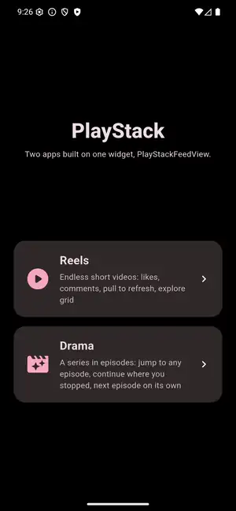

# playstack

Short-video feeds and native video playback for Flutter. Put a
Reels/Shorts/TikTok-style feed on screen with one widget, or drive single
players yourself. PlayStack handles the native players, preloading,
memory, network and lifecycle.

Engines: AndroidX Media3 ExoPlayer (Android), AVFoundation (iOS) and
`HTMLVideoElement` (web).

<p align="center"></p>

## Features

- **One-widget feed.** `PlayStackFeedView` takes your items and does the rest:
  paging, playing the video in view, preparing the next ones, loading
  more, posters, fullscreen.
- **Instant swipes.** A bounded pool of native players reused by
  priority. The next videos are prepared ahead within network, memory and
  decoder limits, and stale preparations are cancelled when the user
  swipes fast.
- **Replaceable controls.** Default controls (tap or hold to pause, sound,
  fullscreen, speed and subtitles, a seekable progress bar, buffering,
  retry), your own layer on top, or your own controls from reusable parts.
- **Mixed feeds.** Ads and cards between videos, locked (paid) episodes,
  and feeds prepared on the splash screen.
- **Transitions and direction.** Slide, parallax, stack, fade, zoom, cube
  or your own; vertical or horizontal, normal or reversed.
- **App-aware.** Pauses under pushed routes, in hidden tabs and in the
  background. Pull to refresh and watch-time reports are one callback
  each.
- **Disk cache, fullscreen with orientation restore, audio focus and
  interruptions, automatic retry, tracks and subtitles, typed errors.**

## Install

```bash
flutter pub add playstack
```

| | Minimum |
| --- | --- |
| Flutter / Dart | 3.47 / 3.13 |
| Android | API 24 |
| iOS | 15.0 |

No platform setup is needed for HTTPS videos. For `http://` URLs, HLS in
non-Safari browsers and the iOS silent switch, see
[Installation](https://github.com/ANILSRGT/playstack/blob/main/docs/guides/installation.md).

## A feed in one widget

```dart
import 'package:playstack/playstack.dart';

PlayStackFeedView<Post>(
  items: posts,
  videoUrl: (post) => post.videoUrl,
  posterUrl: (post) => post.thumbnailUrl,  // optional: shown until the first frame
  onLoadMore: () => api.fetchMorePosts(),  // optional: return [] at the end
)
```

A list of URL strings needs nothing else: `PlayStackFeedView(items: urls)`.

### Your UI on top

`controlsBuilder` gets each page, with your item typed as `page.data`:

```dart
PlayStackFeedView<Post>(
  items: posts,
  videoUrl: (post) => post.videoUrl,
  controlsBuilder: (context, page) => PlayStackDefaultControls(
    page: page,
    onDoubleTap: () => like(page.data),
    child: PostCaption(post: page.data),   // your caption, buttons, avatar
  ),
)
```

Replace the defaults completely with your own widget; `PlayStackProgressBar`,
`PlayStackBufferingIndicator` and `PlayStackMuteButton` are there to reuse.

### Everything else is optional

```dart
PlayStackFeedView<Post>(
  items: posts,
  videoUrl: (post) => post.videoUrl,
  transition: PlayStackFeedTransition.stack,         // slide, parallax, stack, fade, zoom, cube, custom
  scrollDirection: Axis.horizontal,             // stories, carousels
  onRefresh: () => api.fetchPosts(page: 0),     // pull to refresh; off when null
  onItemViewed: (view) => analytics.watched(    // called when the user leaves a video
    view.data.id, view.watchTime, view.completed,
  ),
  controller: viewController,                   // nextPage, jumpToItem, fullscreen, mute, pause
)
```

### Ads, locked episodes and splash preloading

```dart
PlayStackFeedView<Entry>(
  items: entries,
  videoUrl: (e) => e is Video ? e.url : null,        // null: a page without video
  pageBuilder: (context, e, isActive) => AdCard(e as Ad),
  isLocked: (e) => e is Video && !e.unlocked,        // never prepared or played
  lockedBuilder: (context, e, isActive) => Paywall(e as Video),
)

// On the splash screen: the first videos are ready before the feed opens.
final reels = PlayStackFeedPreload<Post>(items: posts, videoUrl: (p) => p.url);
PlayStackFeedView<Post>.preloaded(reels);
```

### Series

The same widget plays a series: open it at an episode, continue where the
user stopped and move on when an episode ends.

```dart
PlayStackFeedView<Episode>(
  items: series.episodes,
  videoUrl: (episode) => episode.url,
  initialIndex: series.episodes.indexOf(tapped),
  startPosition: (episode) => progress[episode.id],           // continue watching
  onItemViewed: (view) => progress[view.data.id] = view.position,
  autoAdvance: true,                                          // next episode
)

viewController.jumpToItem(series.episodes[7]);               // episode list
```

## A single player

```dart
final manager = PlayStackManager();
await manager.initialize();
final controller = manager.createController(
  PlayStackSource.network('https://example.com/video.m3u8'),
);

PlayStackVideoView(controller: controller, fit: BoxFit.cover);  // frames only, no controls
await controller.play();                                   // prepares on demand

await manager.dispose();                                   // releases every player
```

`PlayStackPlayerController` is a `ValueListenable<PlayStackPlaybackState>`: build
your controls from it.

## Platform support

| | Android | iOS | Web |
| --- | --- | --- | --- |
| HLS / DASH | Yes / Yes | Yes / No | Safari or HLS.js / No |
| Network, asset, memory sources | Yes | Yes | Yes (no custom headers) |
| File sources | Yes | Yes | No |
| Disk cache | Progressive + HLS/DASH segments | Progressive | Browser cache |
| Fullscreen and orientation | Yes | Yes | Fullscreen API |

[Full matrix](https://github.com/ANILSRGT/playstack/blob/main/docs/guides/platforms.md).
`PlayStackPlatformCapabilities` reports what the running engine supports.

## Learn more

- [Guides](https://github.com/ANILSRGT/playstack/blob/main/docs/README.md):
  feeds, controller, manager, preloading, caching, fullscreen, audio,
  subtitles, errors, performance
- [Demo app](https://github.com/ANILSRGT/playstack/tree/main/demo): a reels
  app (likes, comments, explore grid, live stats) and a drama app
  (episodes, continue watching, episode list)
- [Benchmarks](https://github.com/ANILSRGT/playstack/blob/main/docs/BENCHMARKS.md)
- [Issues](https://github.com/ANILSRGT/playstack/issues)

Development preview: verified on an Android emulator, an iOS simulator
and headless Chromium; not yet on physical devices.
